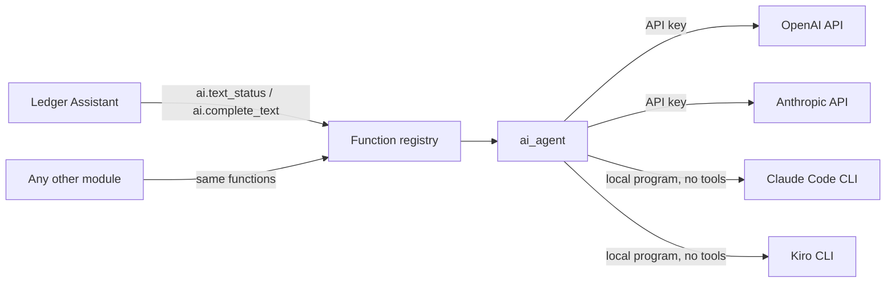

# AI Agent (`ai_agent`)

The bridge between the app's modules and AI vendors. It holds the provider
choice, the API keys and the models, and answers text questions through two
registry functions. It has no features of its own: a module that needs AI
calls the functions by name and never sees a key or a vendor. Off until
enabled in Settings → Modules.

Callers ask the registry, the registry runs the AI Agent's code, and the AI
Agent sends the question to the one provider selected in Settings → AI Agent:
OpenAI or Anthropic over their APIs with the stored key, or Claude Code or
Kiro as a program on the server.

## Files

| File | Contents |
|------|----------|
| `index.py` | `AIAgentModule`: config table, registry functions, settings tab, model-list and connection-check routes, the one-time copy of the AI Parser's settings |
| `vendors.py` | OpenAI and Anthropic text completion; error messages for vendor HTTP errors |
| `cli.py` | Claude Code and Kiro CLI, run as local programs without tools |
| `catalog.py` | Provider names, default and fallback models, live model listing, the model cache |
| `templates/` | Settings tab |

## Registry functions

| Function | Method | Notes |
|---|---|---|
| `ai.complete_text` | `complete_text(system, user, max_tokens, provider=None)` | The selected provider's reply text, or the provider the caller names (a module that lets the owner choose); `external=True` (the message leaves the app). `max_tokens` is not passed to a CLI |
| `ai.text_status` | `text_status(provider=None)` | `{'available', 'provider', 'reason'}`; the reason says what to configure |
| `ai.list_providers` | `list_providers()` | `{'data': [{'id', 'name', 'kind' ('api' or 'cli'), 'model', 'available', 'reason', 'selected'}]}`; no key |

A question that cannot be answered now (no key, CLI agents off, binary
missing) raises `FunctionUnavailable` with that reason. The API key is read
inside the module and never returned. A module that declares the same two
names, also one from outside this repository, replaces this one for them.

## Providers

| Provider | How it answers | Needs |
|---|---|---|
| OpenAI | Chat Completions, `system` + `user` messages, `max_completion_tokens` = 4 × `max_tokens` (reasoning tokens count toward it) | API key |
| Anthropic | Messages API, `system` parameter, `max_tokens` | API key |
| Claude Code CLI | `claude -p --output-format json --safe-mode --restricted --tools "" --permission-prompts none --no-session-persistence --system-prompt <instruction> [--model M]`, message on stdin | `AI_AGENT_ALLOW_CLI=1`, `claude` installed and logged in |
| Kiro CLI | `kiro-cli chat --v2 --agent contaautonomo-ai-agent --no-interactive --wrap never [--model M]`, a workspace agent with no tools; instruction and message on stdin, instruction first | `AI_AGENT_ALLOW_CLI=1`, `kiro-cli` installed and logged in |

Each CLI run gets an empty temporary directory and no tools, so the agent can
only answer. The v3 Kiro engine is not used: in a test on 2026-11-16 it ran a
shell command although only `fs_read` was trusted. A run blocks one web
worker for up to the timeout.

Server environment (never the settings form):

| Variable | Default | Effect |
|---|---|---|
| `AI_AGENT_ALLOW_CLI` | off | `1` lets the AI Agent run a CLI agent |
| `AI_AGENT_CLAUDE_BIN` | `claude` on `PATH` | Another path to Claude Code |
| `AI_AGENT_KIRO_BIN` | `kiro-cli` on `PATH` | Another path to the Kiro CLI |
| `AI_AGENT_CLI_TIMEOUT` | 180 | Seconds before a run is stopped (minimum 10) |

When an `AI_AGENT_*` variable is not set, the AI Parser's `AI_PARSER_*`
variable of the same name is used, so a server set up for the AI Parser's CLI
agents keeps working. A set `AI_AGENT_*` variable wins (`AI_AGENT_ALLOW_CLI=0`
turns CLI agents off for the AI Agent even when the AI Parser may run them).

## Settings

Settings → AI Agent: the active provider, the API keys (encrypted at rest,
`secret_box`), a model per provider, "Refresh list"
(`POST /ai-agent/models/<openai|anthropic|kiro_cli>/refresh`) and "Check
connection" (`POST /ai-agent/check`, one short question to the saved
provider). Form fields are prefixed `agent_`, so they never mix with the AI
Parser's `ai_` fields. Saving writes the activity-log entry
`ai_agent_settings_saved`.

**Taking over the AI Parser's settings.** When the module is enabled and has
no settings yet, it copies the provider, the models, the model cache and the
API keys stored by the AI Parser (`ai_parser_config`, read with SQL — the AI
Parser is not imported); the keys stay encrypted. A document-only provider
(Google Document AI) becomes the API vendor that has a key. This happens once
(activity-log entry `ai_agent_settings_copied`); after that the two modules'
settings are separate. The AI Parser keeps its own settings for reading
documents.

## Data

Table `ai_agent_config` (one row): `provider`, `openai_api_key`,
`openai_model`, `anthropic_api_key`, `anthropic_model`, `claude_cli_model`,
`kiro_cli_model`, `models_cache`. What a caller sends in `ai.complete_text`
goes to the selected provider; the module stores none of it and logs no
question or reply.

## Tests

`tests/test_ai_agent.py`. The SDKs are stubs and `subprocess.run` is a
recorder: tests never call a provider or run a CLI.
