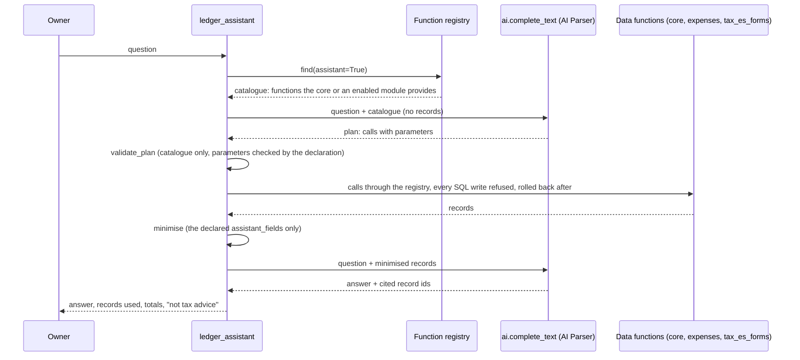

# Ledger Assistant (`ledger_assistant`)

Ask questions about the books in plain language — "how much did I invoice
ACME in Q3?" — and get an answer with the records it is based on. Opt-in:
the module is off until enabled in Settings → Modules.

It names no other module. It reads with the registry functions whose
declaration allows the assistant (`functions.Function`, `assistant=True`),
and asks with `ai.complete_text` and `ai.text_status` — today provided by the
AI Parser with whichever provider is selected there (OpenAI, Anthropic, Claude
Code CLI or Kiro CLI). A module that declares the same functions,
also one from outside this repository, replaces either side without a change
here: with the AI Parser disabled it is used; with both enabled the first to
register owns the names, and the other's card in Settings → Modules says so.

## How a question is answered

1. **Plan.** The text function gets only the question and the catalogue —
   name, parameters and summary of each function the assistant may call:
   `ledger.list_invoices`, `ledger.list_customers` (core),
   `ledger.list_expenses` (expenses), `tax.draft_303`, `tax.draft_130`
   (tax_es_forms), each only while something implements it.
2. **Read.** Calls outside the catalogue, paging parameters, and parameters
   the declaration refuses are dropped and shown under "Lookups". The rest run
   through `core.functions.call`, at most 5 calls and 500 records each; the
   assistant pages itself.
3. **Answer.** Only the declared `assistant_fields` go out: invoices — id,
   number, date, customer name, EUR amount, currency, status; expenses — id,
   date, category, first line of the description (80 characters), amount,
   currency; customers — id, name, country, VAT treatment; drafts — form,
   year, quarter and boxes. E-mails, VAT numbers, addresses, notes, files,
   settings and credentials are never sent.
4. **Show.** The answer, the records it cites (all sent records when it
   cites none), a deterministic total of the listed amounts, and the
   disclaimer.

## Read-only

- The registry refuses a declaration that offers the assistant a function
  that is not read-only or that sends data out; a plan cannot name anything else.
- While the calls run, `read_only()` refuses every SQL statement other than
  `SELECT` (SQLAlchemy `before_cursor_execute`), and the session is rolled
  back afterwards — even an implementation with a side effect cannot write.
- The module never sees an API key: `ai.complete_text` returns only the reply.
- No tables, no activity-log entry; the question is not logged. A failed read
  shows a fixed message; the details go to the server log.

## When it cannot answer

The page and the settings panel say what is missing: no enabled module
implements the text functions (enable the AI Parser), or `ai.text_status`
gives the reason (Google Document AI or a CLI agent selected, no API key).

Dependency: `ledger.list_invoices`, which the core implements, so enabling
the assistant enables nothing else.

## Tests

`tests/test_ledger_assistant.py` — with a stand-in text module instead of the
AI Parser, which is the replacement path in practice.
