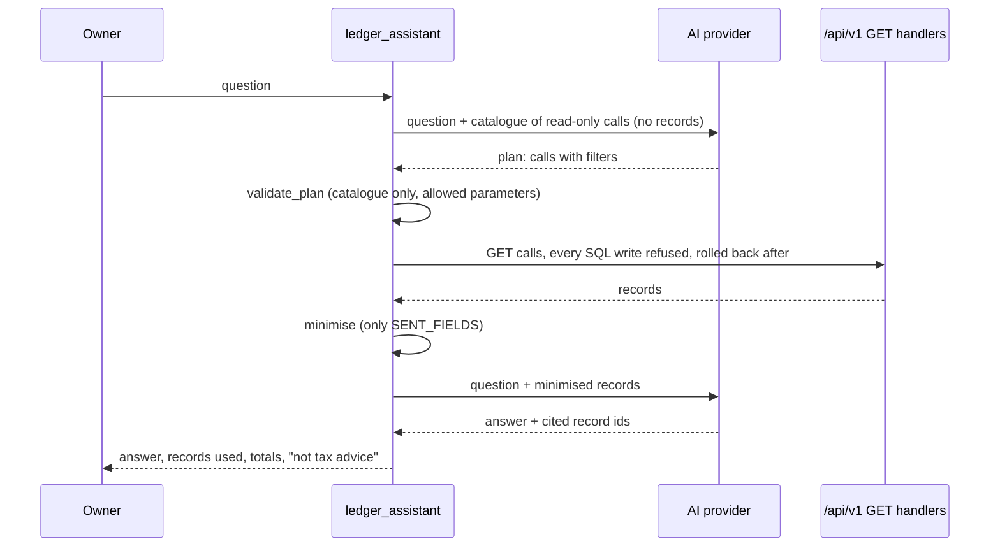

# Ledger Assistant (`ledger_assistant`)

Ask questions about the books in plain language — "how much did I invoice
ACME in Q3?" — and get an answer with the records it is based on. Opt-in:
the module is off until enabled in Settings → Modules. It uses the provider
configured in the AI Parser (OpenAI or Anthropic).

## How a question is answered

1. **Plan.** The provider gets only the question and the catalogue in
   `assistant.py` (invoices, expenses, customers, Modelo 303/130 drafts) and
   returns the calls it needs.
2. **Read.** Calls outside the catalogue, unknown parameters or malformed
   values are dropped and shown under "Lookups". The rest run in-process
   against the `api` module's GET handlers (`_list_invoices`,
   `_list_expenses`, `_list_customers`, and module drafts through the GET
   dispatcher), at most 5 calls and 500 records each.
3. **Answer.** Only the fields in `SENT_FIELDS` go to the provider:
   invoices — id, number, date, customer name, EUR amount, currency, status;
   expenses — id, date, category, first line of the description (80
   characters), amount, currency; customers — id, name, country, VAT
   treatment; drafts — the boxes. E-mails, VAT numbers, addresses, notes,
   files, settings and credentials are never sent.
4. **Show.** The answer, the records it cites (all sent records when it
   cites none), a deterministic total of the listed amounts, and the
   disclaimer.

## Read-only

- The catalogue contains GET calls only; a plan cannot name anything else.
- While the calls run, `read_only()` refuses every SQL statement other than
  `SELECT` (SQLAlchemy `before_cursor_execute`), and the session is rolled
  back afterwards.
- The module has no tables and writes no activity-log entry; the question is
  not logged.

## When it cannot answer

The page and the settings panel say what is missing: the AI Parser module
not enabled, Google Document AI selected (it cannot answer questions), or no
API key stored. The API module is a dependency and is enabled with this one.

## API filters

`GET /api/v1/invoices` accepts `date_from`, `date_to` (`YYYY-MM-DD`) and
`client` (part of the name), and returns `customer_id`; `GET /api/v1/expenses`
accepts `date_from`, `date_to` and `category`. All optional; existing clients
are unaffected.

## Tests

`tests/test_ledger_assistant.py`.
