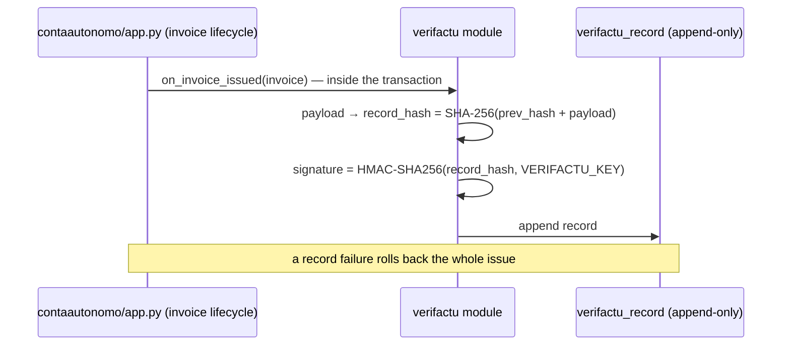

# Verifactu (`verifactu`)

Tamper-evident, hash-chained billing records for issued and annulled invoices —
a compliance assist for Spain's RD 1007/2023 (Verifactu). Every invoice
**issue** or **annulment** appends one record to an append-only hash chain, in
the same database transaction as the lifecycle transition: if the record cannot
be written, the transition is rolled back.

## Contents

1. [How the chain works](#how-the-chain-works)
2. [What is implemented](#what-is-implemented)
3. [When the obligation starts](#when-the-obligation-starts)
4. [Signing key](#signing-key)
5. [Event log](#event-log)
6. [Official specifications](#official-specifications)
7. [Pending items (verify before real use)](#pending-items-verify-before-real-use)

## How the chain works

Each record stores the fiscal payload (canonical JSON), the previous record's
hash, its own hash, and a signature. Modifying or removing any historical
record breaks every later hash — `verify_chain()` detects tampering, broken
linkage, and signature mismatches, and the status page raises a prominent
alarm when the chain is broken.

## What is implemented

| Item | Details |
|------|---------|
| Record chain | `chain.py` — pure functions; SHA-256 linkage, HMAC-SHA256 signature with a dedicated key (see [Signing key](#signing-key)), full-chain verification |
| Lifecycle hooks | `on_invoice_issued` → *alta*, `on_invoice_annulled` → *anulación*; rectificative linkage is embedded in the alta payload; hooks are issue-blocking |
| Status page | `/verifactu/` — health of both chains (billing and event records), record count, latest records and events, obligation dates, **Check both chains now** |
| Export | `/verifactu/export` — NDJSON of the billing records of a period (all by default); `/verifactu/events/export` — the event records of a period as XML files in a ZIP. Each export is an event. Records live in the normal database and are therefore covered by the backup module |
| Event log | `events.py`, `event_log.py` — the registro de eventos of a NO VERI\*FACTU system; see [Event log](#event-log) |
| QR code | AEAT-style payload (`nif`, `numserie`, `fecha`, `importe`) rendered as SVG with ReportLab (no extra dependency); shown on the invoice view panel |

## When the obligation starts

Checked on 25 November 2026. The same table, with its sources, is in
`obligations.py` and on the status page.

| Who | From | Status | Source |
|-----|------|--------|--------|
| Every obligated taxpayer: Impuesto sobre Sociedades taxpayers, autónomos and everyone else | 6 October 2028 | In force | Real Decreto-ley 43/2026, de 24 de noviembre (BOE-A-2026-24701), disposición final primera: the end of the 24-month period of Real Decreto 238/2026, disposición final cuarta.1.b), counted from Orden HAC/1028/2026 (in force 6 October 2026) |
| Taxpayers of the Impuesto sobre Sociedades | ~~1 January 2027~~ | Superseded | Real Decreto-ley 15/2025 (BOE-A-2025-24446), replaced by Real Decreto-ley 43/2026 |
| Autónomos and every other obligated taxpayer | ~~1 July 2027~~ | Superseded | Real Decreto-ley 15/2025, replaced by Real Decreto-ley 43/2026 |

Verifactu now starts on the same day as the B2B e-invoicing obligation for
autónomos. When a later norm moves the date again, follow the update
procedure in the docstring of `obligations.py`.

B2B e-invoicing has its own dates (6 October 2027, 6 October 2028 and 6 October
2029 for status reporting); see
[`modules/einvoice/README.md`](../einvoice/README.md).

## Signing key

Records are signed with a key used only for Verifactu, so rotating
`SECRET_KEY` (sessions, CSRF) never breaks the chain.

| Source | Used when |
|--------|-----------|
| `VERIFACTU_KEY` environment variable | set and not empty |
| Key file (`instance/verifactu.key`, override with `VERIFACTU_KEY_FILE`) | otherwise; created with mode `0600` on first use |

Each record stores `key_id`, a short public fingerprint of the key that signed
it. The status page uses it to pick the right key for each record and reports
"signed with an unknown key" when that key is no longer available.

Keep a copy of the key in a password manager and include it in your recovery
plan: the key file is not part of the database backup.

**Upgrade from earlier versions.** Records written before this key existed were
signed with a key derived from `SECRET_KEY` and have no `key_id`. When the
module starts it adds the `key_id` column and re-signs those records with the
new key — only the signature changes; record hashes and the chain stay the
same. A record whose signature does not verify with the current `SECRET_KEY`
is left untouched, so a real problem remains visible on the status page. Run
the upgrade with the same `SECRET_KEY` the records were written with.

## Event log

A system that does not send its records to the AEAT («NO VERI\*FACTU», the
default `VERIFACTU_MODE=no_verifactu`) must also keep a log of events
(*registro de eventos*, Orden HAC/1177/2024, artículo 9). The module keeps it
in the `verifactu_event` table, append-only, chained like the billing
records: each event carries the type, time and hash of the one before it.

| Code | Event | When the app records it |
|------|-------|-------------------------|
| 01 | Start of operation as NO VERI\*FACTU | Start-up, when the log is new or the last start/end event is 02 (once, whichever worker starts first) |
| 02 | End of operation as NO VERI\*FACTU | Start-up with `VERIFACTU_MODE=verifactu`, or the module is disabled |
| 03, 05 | Anomaly detection started (billing records, event records) | Every day at 03:30 and with **Check both chains now** on the status page; with the number of records checked |
| 04, 06 | Anomaly detected | By those checks and by the status page, which checks both chains on every view; each anomaly is recorded once (until a check finds the chain clean again), with its type (list L1E) and the record it concerns |
| 07 | Backup restored | The Backup module's `backup_restored` or `demo_data_loaded` activity entry (an activity listener) |
| 08 | Billing records of a period exported | `/verifactu/export?date_from=&date_to=`; with the first and last record, counts and totals |
| 09 | Event records of a period exported | `/verifactu/events/export?date_from=&date_to=`: a ZIP with one XML file per event |
| 10 | Summary of events | Every six hours (checked every 30 minutes) and when the process that runs the scheduler stops; counts the events by type and the billing records made since the previous summary |

- **Hash** (`events.huella_evento`): SHA-256 of
  `NIF=…&ID=…&IdSistemaInformatico=…&Version=…&NumeroInstalacion=…&NIF=…&TipoEvento=…&HuellaEvento=…&FechaHoraHusoGenEvento=…`,
  64 uppercase hexadecimal characters, as section 3.c of the AEAT hash
  specification (v0.1.2) lists. The first event has an empty `HuellaEvento`.
- **Time**: `FechaHoraHusoGenEvento` in Europe/Madrid with its offset
  (`2026-11-26T10:00:00+01:00`); a time more than a minute ahead of the
  clock is an anomaly (type 13).
- **No fork**: `prev_huella` is unique, so two workers cannot both append
  after the same event; the second builds its record again.
- **XML** (`events.event_xml`): the *RegistroEvento* design of
  `EventosSIF.xsd`, with *DatosPropiosEvento* for events 03–06, 08–10. The
  `ds:Signature` (XAdES with a qualified certificate, artículo 14) is not
  produced: each event is signed with the Verifactu key (HMAC-SHA256), as the
  billing records are; the XML carries that signature in a comment.
- **Settings → Verifactu** names the system in each event: producer (name and
  NIF; default the owner), system name and two-character code (default
  `ContaAutonomo`, `CA`), installation number (created once). Version:
  `<APP_VERSION>+vf<module version>`. Each event stores the values it was
  hashed with, so changing them later does not break earlier events.
- In VERI\*FACTU mode no event is recorded (only the 02 that ends the log).

## Official specifications

[SPEC_COMPARISON.md](SPEC_COMPARISON.md) compares the module with the AEAT
technical documents (hash v0.1.2, QR v0.5.0) and lists the remaining work.

- `aeat.py` implements the official record hash (*huella*) — verified against
  AEAT's worked examples — and the cotejo URL.
- Every generated PDF of an issued invoice carries the QR on page 1
  (`pdf_qr.py`, through the core `filter_invoice_pdf` hook): 30 mm, error
  correction M, "QR tributario:" above it. The module also declares the QR
  as an invoice designer block (`get_invoice_blocks`: required, top-centre or
  top-left, 30, 35 or 40 mm), so a designer template places it where the user
  chose; the hook then leaves the PDF as it is (`pdf_qr.has_qr`). The draft PDF stored when the
  invoice was created is discarded at Issue, so the issued PDF is rebuilt with
  the QR. A PDF the user attached (Invoice Attachments) is served as uploaded,
  without a QR.
- `VERIFACTU_MODE` (default `no_verifactu`) selects `ValidarQRNoVerifactu`
  and omits the "VERI*FACTU" phrase. Switch to `verifactu` only when records
  are submitted to AEAT. `VERIFACTU_QR_ENV=test` uses the AEAT test host.
- **Submission to AEAT is not available** (needs AEAT test access).

## Pending items (verify before real use)

- **Specification alignment**: the record field list, hash input ordering, QR
  URL format and signature requirements must be validated against the official
  AEAT technical annexes for RD 1007/2023. Everything is versioned
  (`CHAIN_SPEC_VERSION = "draft-1"`), so aligning with the final specification
  is a data migration rather than a redesign.
- **VERI*FACTU submission**: the scheduler job is scaffolded but does nothing
  until a `VERIFACTU_ENDPOINT` is configured; the real implementation requires
  access to the AEAT test environment.
- **Signature**: HMAC is a placeholder, for billing records and event records alike. The final specification may require
  certificate-based signing; the PFX upload flow in `pdf_signature` is the
  natural reuse candidate.
- **Record format**: the chain still uses the draft hash format; switching to
  the official huella is the next step (see SPEC_COMPARISON.md).

This module is a compliance assist, not legal advice.
